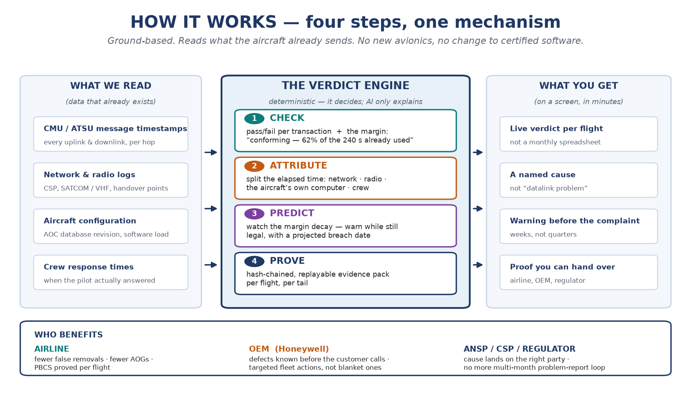

# DATALINK: FROM COMPLAINTS TO PROOF

**One document. Everything else is in `working/` if you need the detail.**

---

## 1. In one paragraph

Every aircraft flying the North Atlantic or Pacific must answer an air traffic control message within **240 seconds**. That is a legal requirement, not a target. Today nobody checks it flight by flight. It is checked **once a month, by hand, in a spreadsheet**. So when something goes wrong, the airline finds out weeks later — from a pilot complaint — and usually blames the wrong system.

We check **every message, in real time**, against its deadline. We show **how much of the 240 seconds was used**. We work out **where the time went** — the network, the radio, the aircraft's own computer, or the crew. We warn **before** the deadline is broken. And we hand over **proof** that anyone can re-check.

---

## 2. The problem, in plain English

A clearance goes out from a controller to the aircraft. Four things can slow it down:

1. the **network** (satellite or ground link),
2. the **radio** (VHF or SATCOM, and the switch between them),
3. the **aircraft's own computer** (the unit that routes and queues the message),
4. the **crew** (how long the pilot takes to answer).

Right now, only the first two are visible. The third — the aircraft's computer — is a **black hole**. When a message takes 310 seconds, the network says "we delivered in 40", the radio says "I transmitted", and the computer says nothing. So the network gets blamed, a perfectly good radio gets pulled off the aircraft, and the real fault keeps happening on 200 other aircraft.

### Five numbers that make the case

| What | Number |
|---|---|
| Legal deadline for a datalink clearance (RCP 240) | **240 seconds** for 95% of messages |
| How often compliance is measured today | **once a month**, in a spreadsheet |
| Avionics removed that turn out to be fine (no fault found) | **20–50%** |
| Cost of one aircraft on ground (AOG) | **USD 10,000–150,000 per hour** |
| Aircraft we can currently show a per-flight compliance record for | **0** |

The industry says this itself. Europe's SESAR programme notes that the performance manual covers "only post-implementation monitoring" — there is **no real-time layer**. And the FAA notes that when a fleet's performance drops below the required level, it "will usually be accompanied by **controller complaints**." In other words: **the complaint is the monitoring system.**

---

## 3. The idea

Four steps. One engine. No new hardware on the aircraft, and no change to any certified software — it all runs on the ground, on data the aircraft already sends.

| Step | What it does | What you see |
|---|---|---|
| **1. CHECK** | Every message is tested against its deadline | "Failed — 310 seconds, 70 over." Or: "Passed — 148 seconds, **62% of the budget used**" |
| **2. ATTRIBUTE** | The time is split between network, radio, aircraft computer and crew | "180 of the 310 seconds were queued **inside the aircraft's computer**. The network was clean." |
| **3. PREDICT** | The margin is tracked over time | "This aircraft's typical time has grown 12 seconds a week for six weeks. It crosses 240 in 11 days." — **said while every flight is still legal** |
| **4. PROVE** | Each verdict is sealed and replayable | A record the airline, the manufacturer and the regulator can all re-run and get the same answer |

### Why this is believable, not magic

- We start with **three requirements**, not 128.
- The **rule decides; the AI only explains**. Switch the AI off and the product still works — which is why safety people can accept it.
- We read **data that already exists**. No new sensors, no certification change.
- We read **40+ patents and the full rule set** before writing the claim.

### One real example

737-8s on Pacific crossings were missing the 240-second deadline. The network was blamed for weeks.

We looked at the messages: the delay was **180 seconds inside the aircraft's computer**, caused by a database revision during VHF→SATCOM handovers. The network was proved clean. The fix was tested in a simulator and rolled out to **23 aircraft — not 200**. A fleet-wide grounding action was avoided, and so was a warranty claim.

---

## 4. Why we are different

There are **28 granted patents** that predict things in this space. Every one of them predicts one of two things: **the link** (will the satellite drop out, when do we hand over) or **the box's health** (will this unit fail, when does it need overhaul).

| They predict | Examples | Why it doesn't solve our problem |
|---|---|---|
| The **link** — outage, handover, coverage | Panasonic, Qualcomm, Viasat, Satcom Direct | A perfect link can still miss the deadline because of what happens **inside** the aircraft |
| The **box's health** — failure, remaining life | Rockwell, Honeywell, Boeing, Airbus | Our problem is not a broken box. It is **slow, working** equipment — and who caused the slowness |
| **Which link to use** | Honeywell | Sends better. Doesn't measure or prove what happened |
| **Performance monitoring** (closest) | Satcom Direct, US 2025/0260475 | Already names the slowest transmission step — but stops at the radio. No view inside the aircraft, no early warning, no proof document |

### What nobody else claims together

1. **The margin**, not just pass or fail — *how much of the 240 seconds was used*. That is the number that lets you see trouble coming.
2. **Attribution inside the aircraft's own computer** — not just "the network was slow".
3. **Warning while the flight is still legal** — projecting a deadline breach from the trend, not from a failure.
4. **A proof document** — sealed, replayable, plus a live statement of which requirements the fleet has never actually tested.

> **Say it like this:** *"Everyone else predicts the link, or the health of the box. We predict — and prove — the requirement."*

---

## 5. Who benefits

| Who | What they get | What it is worth (our estimate) |
|---|---|---|
| **Airline** | Problems found before the complaint. Evidence in minutes, not months. Fewer good parts thrown away. Proof of compliance per flight. Protection against losing 240-second approval — which would force the fleet back to wider, slower separation | **USD 1.4–5.0 M per year per 500 aircraft.** One avoided AOG can pay for a year |
| **Aircraft manufacturer (Honeywell)** | Learns how its own product behaves in service — before the customer calls. Warranty claims settled with evidence instead of argument. Fleet fixes aimed at 23 aircraft instead of 200. A new service to sell on the installed base | **USD 1.7–6.5 M per programme per year** — enough to fund 30–60% of the airline's subscription |
| **Air navigation service / satellite provider** | The cause lands on the right party. Fewer months-long investigations | Fewer disputes, cheaper problem reports |
| **Regulator** | Objective, replayable evidence instead of complaint-driven monitoring | Better oversight for less effort |

**Why the airline does not pay alone:** the manufacturer saves USD 1.7–6.5 M and sponsors part of the airline's fee. It pays $1 to save $2–5. That is the commercial trick that makes the sale easy.

**Market:** aircraft health monitoring is **USD 4.9 B today, 7.4 B by 2030** (8.3% a year). The slice we want — datalink requirement assurance — is roughly **USD 100–150 M a year, and no product sits in it.**

---

## 6. What we are asking for

**A 90-day test, not a product.**

Three requirements. One airline's data. Our own receivers plus a simulator. At the end of it, two numbers decide whether this is real:

- **Do we catch at least 60% of problems before any complaint arrives?**
- **Can we produce the evidence in under 15 minutes?**

If not, the idea is wrong and we say so. If yes, we file the patent before showing anyone outside.

---

## 7. What is solid and what is estimated

Being straight about this is what makes the rest believable.

**Solid — checked against public sources:**
the 240-second requirement and how it is written · the monthly spreadsheet monitoring · the FAA and SESAR statements quoted above · 20–50% no-fault-found removals · AOG cost range · the 28 patents and what they claim · the market size figure.
*(Sources: FAA AC 90-117, FAA FIT reports 20/24/27, SESAR PJ.14-W2-76, MDPI *Aerospace* 5(2):38, IATA FY2024 benchmarking, The Business Research Company, and our own patent reading in `working/`.)*

**Estimated — our planning numbers, to be tested with customers:**
the USD 1.4–5.0 M airline saving · the USD 1.7–6.5 M manufacturer saving · the USD 3,600–6,000 per aircraft price · the 60% and 15-minute targets.

Do not present estimates as facts. Say "we estimate" and the room stays with you.

---

## 8. If someone asks

**"Isn't this what Satcom Direct already does?"**
They show the slowest transmission step from the network's side. We go one box further in — inside the aircraft's computer — and we hand over a replayable proof. Different claim, different buyer.

**"Why not just improve the monthly report?"**
Because monthly is after the fleet has already been downgraded. The FAA's own wording is that performance drops are normally noticed through controller complaints. We move detection in front of the complaint.

**"Are we touching the aircraft? Is this certified?"**
No. Ground platform. Existing data. No hardware, no software change, no certification. That is why 90 days is possible.

**"Is this just AI?"**
No. A fixed rule decides. The AI explains and suggests, every suggestion is checked and logged, and the product works with the AI switched off.

**"How do you know your attribution is right?"**
Because reality answers back. The box comes off, it is tested on a bench, a software load fixes it or doesn't. Each outcome becomes a label, and the next attribution gets sharper.

**"Who pays first?"**
The airline, per aircraft. The manufacturer co-funds it from its own savings. We start with one fleet and one programme.
