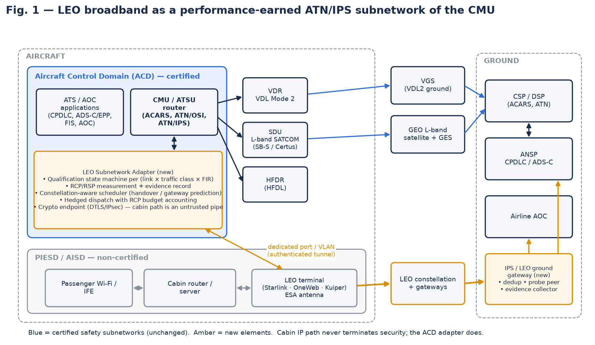
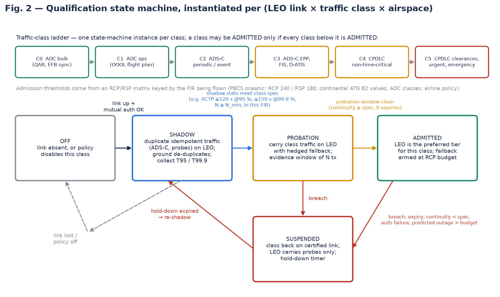
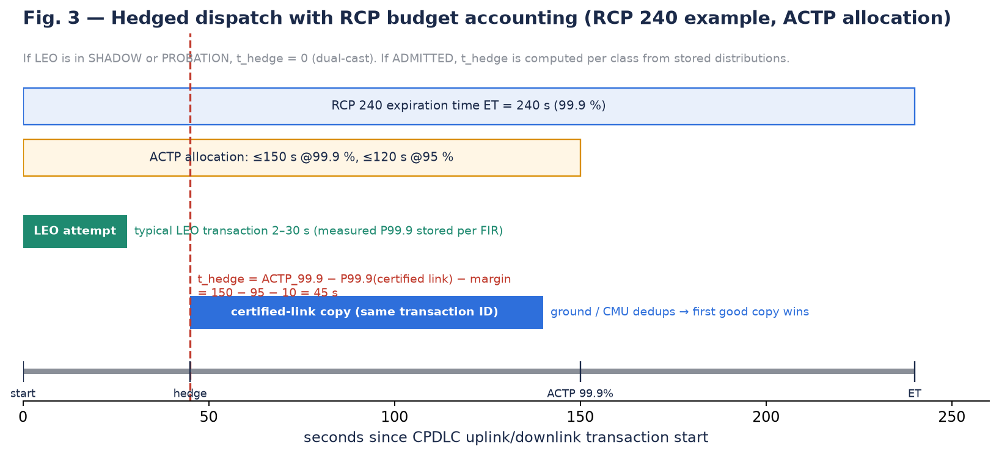

# LEO broadband as a **performance-earned** ATN/IPS subnetwork of the CMU

**Version 2 — rewritten after the patent / prior-art landscape of 2026-10-14**
(landscape: `PATENT_LANDSCAPE_REPORT.md`; dataset: `PRIOR_ART_DATASET.csv`; claims: `DRAFT_CLAIM_SET.md`)

> **One-line pitch (v2).** Treat Starlink / OneWeb / Kuiper not as "another radio in the preference table" but as a
> *candidate* ATN/IPS subnetwork that has to **earn** each class of ATS traffic, in each airspace, by producing on-board,
> signed, statistical RCP/RSP evidence — and that is kept honest by **constellation-aware outage prediction** and
> **RCP-budget hedged dispatch** rather than by reacting to missed acknowledgements.

### Why the rewrite was necessary (read this first)

The original four sections were sound engineering but, as written, **every core element is already published**:

| Original bullet | Already disclosed by |
|---|---|
| "Register LEO as its own CMU preference tier, separate from GEO SATCOM and VDL2" | Honeywell **US7027812B2** (2000): CMU preference tables "easily support addition of new subnetworks by defining new subnetwork codes"; Honeywell **US7729263B2** (2007): rule-based selection incl. Wi-Fi / WiMAX / cellular / ATN; Thales **US8433817B2** |
| "Carry ATN/IPS (or SNDCF over IP) over the terminal's IP path" | ICAO Doc 9896 / ARINC 858 define IPS over any IP access network; **Rockwell Collins France EP4513465A1** (priority 2023-08-21) carries SNDCF / A618 safety traffic over cabin SATCOM or 5G and says the same applies to ATN/IPS |
| "Use LEO first for high-volume AOC and bulk ATS" | Honeywell **US10425149B1** (2018), **EP3654548B1** (2018), EASA/FAA *Future Connectivity* white paper (2022, "Hyperconnected ATM") |
| "Probe LEO RCP/RSP, fall back automatically to certified SATCOM / VDL2" | **EP4513465A1** claims active/passive probing, a Multi-Link Engine and ack-timeout fallback to a safety medium, and cites RCP/RSP (DO-350A); Collins **US11146329B1** (per-message link selection on measured quality); Collins France **US20260006496A1** (policy-gated media admission) |
| "Keep time-critical CPDLC on certified links until RCP is proven" | EP4513465A1 ¶[0038] (ACD router selects which kinds of traffic go via AISD); Satcom Direct **US20250260475A1** (PBCS monitoring vs RCP 240 / RSP 180 with reconfiguration) |

The closest single reference is the **Collins France "Virtual Safety Radio" family (EP4513465A1 / US2025/0069511A1, pending)**.
It is not yet granted, so its final claim scope is unknown; design freedom (FTO) must be re-checked when it issues.
What *nobody* discloses is the **mechanism that turns a non-certified broadband link into an admissible ATS subnetwork
without a recertification campaign**: a graduated, per-class, per-airspace, evidence-producing admission process coupled to
LEO-specific outage prediction. That is where v2 moves the centre of gravity.

---

## 1. Situation (updated)

* **Legacy bearers are saturating.** VDL Mode 2 (~31.5 kbps shared per frequency) and L-band GEO SATCOM (Classic Aero /
  SwiftBroadband-Safety, ~tens to ~200 kbps) remain the only ATS-approved air/ground paths for CPDLC and ADS-C.
  The ATN B2 / EPP roadmap (4-D trajectory downlinks, ~2027 mandates in Europe) and the growth of AOC data (EFB sync, QAR
  snapshots, predictive-maintenance uploads) put more volume on links that were sized for 200-byte messages.
* **Regulators already want the offload — and asked for a standard to govern it.** The EASA/FAA *Future Connectivity for
  Aviation* white paper (Nov 2022) and EASA's "Hyperconnected ATM" roadmap explicitly propose moving AOC and non-RCP traffic to
  cabin SATCOM / LEO-MEO links, provided there is "adequate link status and performance monitoring" and "appropriate security
  protections". No performance-based standard for admitting such a link to ATS exists yet; ICAO Doc 9896 (ATN/IPS) and
  ARINC 858 define *how* a link plugs in, not *when it may be trusted*.
* **Industry is already building the plumbing.** Honeywell (AOIP, US10425149B1), Collins France (VSR, EP4513465A1), Collins
  (LEO/3GPP transceiver EP4572182A1), Satcom Direct (ground PBCS monitoring), Thales Alenia Space (ground 4-D quality maps for
  safety-of-life links) and Chinese ATN/IPS router filings (CN120856635B) all exist. Cabin LEO (Starlink Aviation, OneWeb via
  Panasonic / Intelsat, Kuiper announced) gives 100+ Mbps, ~30–60 ms RTT and polar coverage, but **has no AMS(R)S status,
  no priority/pre-emption and no published availability/continuity figures acceptable for RCP/RSP allocation**.
* **The gap:** the certification problem is not "can the CMU send IPS packets over Starlink" (it can) but "how does an
  operator or ANSP obtain the per-airspace evidence that a commercial LEO service meets RCP 240 / RSP 180 (or continental
  B2 values) *for a given traffic class*, keep obtaining it continuously, and bound the consequence of being wrong".
  Today this is done by multi-year ground monitoring campaigns (cf. FAA PARC approving FANS over SwiftBroadband in 2018).

## 2. Target (updated)

1. **Qualify, don't just configure.** Make the LEO path a CMU/ATSU ATN/IPS subnetwork whose use for each traffic class
   (C0 AOC bulk → C5 urgent CPDLC) is *earned in flight* from measured transaction-time and continuity statistics against the
   RCP/RSP applicable to the FIR being flown, and *revoked automatically* on breach — with no change to the existing certified
   subnetworks or to the ATS end systems.
2. **Bound the risk of being wrong.** Any ATS transaction placed on LEO must still complete within its RCP expiration time if
   LEO silently fails — by hedged dispatch on a certified link timed from the measured certified-link P99.9, not by a fixed
   retry timer.
3. **Turn LEO's peculiarities into schedule knowledge.** Satellite handovers (~every 15 s on a shell), beam / gateway switches,
   no-gateway zones and low-elevation geometry are **predictable** from terminal telemetry and ephemeris; pre-empt them instead
   of discovering them through missed acknowledgements.
4. **Produce the approval evidence as a by-product.** Every LEO transaction leaves a signed per-transaction record
   (class, FIR, timestamps, outcome, link state) that the airline, CSP and PBCS monitoring agencies can consume; the
   admission decisions are reconstructible from it.
5. **Scale to several constellations.** Treat two independent LEO providers (e.g. Starlink + OneWeb / Kuiper) as one
   *composite* subnetwork whose combined availability/continuity is what is evaluated, with an independence check.
6. **Preserve the certified baseline.** VDL2 / HFDL / L-band SATCOM remain untouched and always-armed; the LEO adapter is
   additive (ARINC 858 Part 3 radio-interface semantics towards the IPS router) and fail-safe to "LEO off".

## 3. Proposed solution (updated)

**Architecture (Fig. 1).** A *LEO Subnetwork Adapter* (software partition in the CMU/ATSU, or a small ACD LRU on the
ACD side of the domain boundary) owns a dedicated Ethernet port / VLAN on the cabin LEO terminal. The cabin path is treated as
an untrusted pipe: DTLS / IPsec is terminated in the adapter and in an IPS / LEO ground gateway operated by the CSP/DSP, with
mutual PKI authentication (Doc 9896 / ARINC 858 security). The adapter presents itself to the CMU router as one more
subnetwork with ARINC 858 Part 3 link-status semantics — but with a **per-class, per-airspace admission state** instead of a
single "available / unavailable" flag.

**Element A — Graduated qualification state machine (Fig. 2; claim family 1).** For every tuple
(LEO link × traffic class × airspace / FIR) the adapter keeps a state **OFF → SHADOW → PROBATION → ADMITTED ⇄ SUSPENDED**:

* *SHADOW*: idempotent traffic already being sent on a certified link (periodic ADS-C reports, FIS, probes) is **duplicated**
  on LEO; the ground gateway de-duplicates by transaction ID; the adapter accumulates transaction-time (ACTP/ASP equivalents)
  and continuity percentiles **without any operational dependence on LEO**.
* *PROBATION*: once shadow statistics meet the class's thresholds (e.g. ACTP ≤ 120 s @ 95 %, ≤ 150 s @ 99.9 %, continuity
  ≥ spec, N ≥ N_min samples in this FIR), the class is carried on LEO *with hedged fallback* (Element C) for an evidence window.
* *ADMITTED*: LEO becomes the preferred tier for that class; fallback stays armed at the RCP budget.
* *SUSPENDED*: triggered by any expiry, continuity shortfall, authentication failure or a predicted outage longer than the
  class budget; class returns to certified links, LEO carries probes only, hold-down timer, then back to SHADOW.
* The **class ladder is monotonic**: C3 (ADS-C EPP / bulk ATS) can only be admitted while C0–C2 are admitted; CPDLC
  classes (C4/C5) require an airline/ANSP policy switch *and* a clean history, which is how "keep time-critical CPDLC on
  certified links until RCP is proven" becomes a mechanism rather than a sentence.
* Thresholds come from an **RCP/RSP requirement matrix keyed by FIR** (PBCS oceanic RCP 240 / RSP 180; continental ATN B2
  values; AOC classes by airline policy), so admission in the Shanwick OCA does not imply admission in the North Pacific.

**Element B — Constellation-aware predictive scheduling (claim family 2).** The adapter ingests LEO terminal telemetry
(serving satellite / beam ID, elevation, next handover time, gateway identity, obstruction / scheduled-maintenance flags) and,
where available, public ephemeris, and projects along the 4-D flight plan: handover instants, gateway-switch windows,
no-gateway / inter-satellite-link-only segments, low-elevation geometry near the poles, and regulatory "LEO not permitted"
regions. The result is a *predicted outage calendar*. Transactions whose remaining RCP budget overlaps a predicted outage
are **pre-emptively started on, or moved to, a certified link** (or delayed if the class tolerates it); the admission state
machine treats a predicted outage longer than the class budget as a breach *before* it happens. Nothing in the record does
this on board for a safety-service admission decision (Thales Alenia Space US10453347B2 is ground-side and for certified
AMS(R)S bearers).

**Element C — RCP-budget hedged dispatch (Fig. 3; claim family 1 dependents).** Each ATS transaction is given a transaction
ID and started on LEO. A certified-link copy is launched at
`t_hedge = ACTP_99.9(class, FIR) − P99.9(certified link, measured) − margin` (e.g. 150 − 95 − 10 = 45 s for RCP 240),
not at a fixed retry timeout. The ground gateway / CMU de-duplicates, first good copy wins, the late copy is cancelled where
the bearer allows. In SHADOW / PROBATION, `t_hedge = 0` (full dual-cast). This differs from EP4513465A1's
"re-send over a safety medium after an acknowledgement timeout" because the certified copy is scheduled from the **RCP
budget and the measured certified-link distribution**, and because the LEO attempt is never on the critical path of the RCP
requirement.

**Element D — Composite multi-constellation subnetwork (claim family 3).** Where the aircraft carries terminals for two
independent LEO systems (different operators, orbits, gateways, spectrum), the adapter instantiates the state machine on a
*virtual* subnetwork whose availability / continuity are computed from the union of the two links, with an independence
monitor (correlated-outage detection: same weather cell, same regulatory region, shared aircraft power bus) that collapses the
composite back to the best single link when independence cannot be demonstrated.

**Element E — Signed PBCS evidence record and ground gateway.** Every LEO transaction (shadow or live) produces a signed
record {class, FIR, link state, serving satellite / beam, timestamps, outcome, hedge decision}; the record is uplinked over
whichever link is cheapest and exported in a PBCS-monitoring-agency-compatible format. The IPS / LEO ground gateway
performs de-duplication, probe peering, admission-state mirroring for uplinks (ground applies the same per-class state to
choose the uplink bearer), and evidence collection. This closes the loop with the `datalink-ai` package (AI-assisted PBCS
monitoring) already in this repository.

**Element F — Capability signalling to end systems.** When C2/C3 are ADMITTED the adapter advertises a higher permissible
reporting rate / message size to the ADS-C and EPP functions (and the ANSP contract can request it); on SUSPENDED the
advertised capability drops back, so end systems never over-commit to a bearer that just vanished.

**Embodiments.** 1) Starlink Aviation terminal, dedicated port to a CMU IPS partition (software-only on an IPS-capable CMU).
2) OneWeb / Kuiper. 3) Composite Starlink + OneWeb. 4) Retrofit: a small ACD LRU between CMU (ARINC 429 / Ethernet) and the
terminal, running the adapter — the same pattern Honeywell used to add SB-Safety to legacy radios (US10412051B2).
5) Military / state aircraft with proprietary LEO services. 6) The same state machine applied to 5G ATG or LDACS trials.

## 4. Benefits (updated)

| Stakeholder | Benefit | What makes it credible (and new) |
|---|---|---|
| **Pilot** | CPDLC / ADS-C latency on admitted classes drops from tens of seconds to seconds; fewer "LINK LOST" / timer expiries; no new HMI — the CMU still shows one datalink status | Admission is per class and per FIR; hedged dispatch guarantees the RCP window even if LEO silently fails |
| **Pilot** | Higher-rate ADS-C EPP and FIS/D-ATIS updates when LEO is admitted (capability signalling, Element F) | End systems only increase rates when the state machine says ADMITTED, and step down on SUSPENDED |
| **Pilot** | Polar / oceanic coverage where GEO is marginal; no manual media selection | Composite subnetwork + outage calendar keep a predictable bearer instead of flapping between media |
| **Airline** | Up to 80–90 % of AOC and bulk-ATS bytes off metered VDL2 / L-band SATCOM (airline-policy classes C0–C1 are admitted first and cheaply) | Same mechanism as Honeywell AOIP for AOC, but with a measured path to extending it to ATS classes |
| **Airline** | Avoids a per-fleet recertification campaign: certified subnetworks unchanged, LEO adapter is additive and fails to "LEO off"; software-only on IPS-capable CMUs | Adapter sits in the ACD, terminates security itself, uses ARINC 858 radio-interface semantics |
| **Airline / CSP** | Automatic, signed, per-FIR PBCS evidence usable for operational-approval dossiers and continuous monitoring; reduces the multi-year "monitor first, approve later" cycle | Evidence record (Element E) — nothing in the landscape produces on-board, decision-bound evidence |
| **Airline** | Vendor independence: Starlink, OneWeb, Kuiper or any future IP bearer qualifies through the same state machine; two providers can be pooled | Composite subnetwork (Element D) |
| **ANSP / regulator** | Performance-based, auditable admission of new bearers instead of bearer-by-bearer certification; gives the EASA/FAA Hyperconnected-ATM roadmap the missing admission mechanism | FIR-keyed RCP/RSP matrix; ground gateway mirrors admission state for uplinks |
| **Everyone** | Resilience: predicted outages are scheduled around; certified links are always armed; attacks on the cabin path cannot inject into the ACD because security terminates in the adapter | Elements B, C and the trust boundary in Fig. 1 |

### Residual risks and open points (be honest in the disclosure)

* **Collins France EP4513465A1 is pending.** Its claim 1 currently requires a cross-router interface between the ACD router
  and the AISD/PIESD routers. An embodiment that connects the ACD adapter to a dedicated terminal port / VLAN *without passing
  through the cabin routers* is a possible design-around, but claims can be amended before grant — counsel must track it.
* **No commercial LEO service has AMS(R)S status or priority / pre-emption.** The invention does not fix that; it makes the
  consequence bounded and measurable. Regulators may still cap LEO at non-time-critical classes for years.
* **Statistical sufficiency.** N_min per FIR must be large enough that 99.9 % percentiles are meaningful; the shadow phase may
  take many sectors on thin routes — fleet-level pooling of evidence (via the ground gateway) is the mitigation and should be
  described as an embodiment.
* **Terminal telemetry access.** Element B depends on the LEO operator exposing handover / beam / gateway information through
  the terminal API; the fallback is passive inference from RTT / loss patterns plus public ephemeris.
