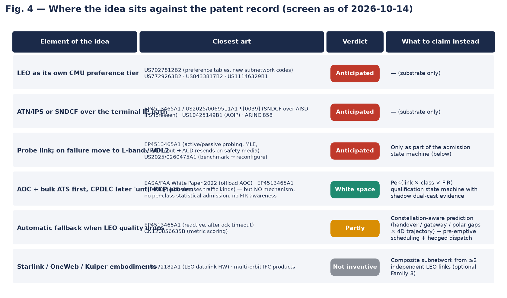

# Patent & prior-art landscape — LEO broadband as a CMU ATN/IPS subnetwork

*Search date: 2026-10-14 · Analyst: automated landscape screen (not a legal opinion) · Dataset: `PRIOR_ART_DATASET.csv` (44 refs)*

## 1. Executive summary

| Question | Answer |
|---|---|
| Is "LEO (Starlink) as a separate CMU preference tier carrying ATN/IPS, used first for AOC / bulk ATS, probed for RCP and falling back to certified SATCOM/VDL2" novel as stated? | **No.** Each element is individually disclosed, and the combination is substantially disclosed by Rockwell Collins France **EP4513465A1 / US2025/0069511A1** (priority 2023-08-21, pending) read with Honeywell **US7027812B2**, **US10425149B1** and the EASA/FAA 2022 *Future Connectivity* white paper. |
| Closest single reference | **EP4513465A1** — Virtual Safety Radio: ACD router sends ACARS / ATN safety messages over cabin SATCOM or 5G when probing says the non-safety link is available; multi-link engine; crypto + metadata; ground gateway; ack-timeout fallback to safety media; RCP/RSP motivation; explicit statement that ATN/IPS is covered. |
| Where is white space? | (1) **Per-(class × airspace) graduated admission** state machine driven by on-board PBCS statistics gathered by **shadow dual-cast**; (2) **LEO constellation-aware predictive scheduling** (handover / gateway / no-coverage calendar vs RCP budget); (3) **RCP-budget hedged dispatch** timed from the measured certified-link distribution; (4) **composite multi-constellation virtual subnetwork** with independence monitoring; (5) signed, decision-bound **PBCS evidence record** exported from the aircraft. None of these were found in patent or non-patent literature. |
| Recommended posture | File quickly (Collins France is actively filing in this exact space — second application US20260006496A1 published 2026-01-01). Independent claims on (1)+(3), (2), and (4); do **not** claim the preference tier, IPS-over-IP or generic probe-and-fallback. Watch EP4513465A1 prosecution for FTO. |
| Confidence | Moderate-high for patents published before ~2025-04; **blind window** for anything filed after that (18-month publication lag). CN filings are active in ATN/IPS multilink (Beihang, CETC Avionics, Tianhua Hangtong) and may contain more than the snippets show. |

## 2. Scope and method

* Idea decomposed into 9 claimable elements (E1 LEO tier in CMU; E2 ATN/IPS or SNDCF over terminal IP; E3 AOC/bulk ATS
  first; E4 RCP/RSP probing + fallback; E5 per-class graduated admission; E6 shadow dual-cast evidence; E7 constellation-aware
  prediction; E8 hedged dispatch at RCP budget; E9 composite constellations / evidence record).
* Sources: Google Patents (page reads and `xhr/query` keyword / CPC searches, CPC H04B7/18506, H04W4/42, H04L45/*, G08G5/*),
  Justia, FreePatentsOnline, assignee-driven sweeps (Honeywell, Rockwell Collins / Collins France, Thales, Airbus, Boeing,
  Satcom Direct, Thales Alenia Space, Iridium, SpaceX, Beihang, CETC), citation chasing from the top hits, and non-patent
  literature (ICAO, RTCA/EUROCAE, AEEC, IETF, EASA/FAA, NASA, trade press). Full protocol in `SEARCH_PROTOCOL.md`.
* Reading depth: full description read for refs 1, 3, 4, 13, 14, 17, 22, 23, 27; abstract / claim-level for the rest.

## 3. Element-by-element verdict

| # | Element of the original idea | Verdict | Key references |
|---|---|---|---|
| E1 | LEO registered as its own CMU subnetwork / preference tier | **Anticipated** | US7027812B2 (preference tables accept new subnetwork codes), US7729263B2, US8433817B2, US8484384B2 |
| E2 | ATN/IPS or SNDCF-over-IP across the terminal's IP path, security terminated in the ACD | **Anticipated / obvious** | EP4513465A1 (SNDCF + A618 over AISD, "similar concept applies to ATN/IPS", crypto, ground tunnel endpoint), ICAO Doc 9896, ARINC 858, US10412051B2 (bolt-on secure adapter precedent), Airbus FAST 2022 (PKI tunnel pattern) |
| E3 | AOC and bulk ATS first, time-critical CPDLC stays on certified links | **Anticipated** | US10425149B1 and EP3654548B1 (AOC over IP, CMU-arbitrated), EP4513465A1 ¶[0038] (ACD router picks traffic kinds), EASA/FAA white paper 2022 |
| E4 | Probe LEO RCP/RSP; automatic fallback to L-band SATCOM / VDL2 | **Anticipated** | EP4513465A1 (active/passive probing, 3-step RTT probe, ack-timeout fallback, DO-350A rationale), US11146329B1 (measured quality selection), US20260006496A1 (policy-gated media info), US20250260475A1 (ground PBCS monitoring + reconfiguration), CN120856635B (IPS link scoring) |
| E5 | **Graduated per-(class × FIR) admission state machine** with PBCS percentile thresholds and monotonic class ladder | **Not found** | Nearest: EP4513465A1 binary availability; US20260006496A1 policy gate on media status; FAA PARC 2018 process (manual, ground, fleet-level) |
| E6 | **Shadow dual-cast** of idempotent ATS traffic to build evidence with zero operational dependence | **Not found** | Nearest: EP4513465A1 probing; US8045977B2 RTT measurement in CMU (congestion only) |
| E7 | **Constellation-aware predictive scheduling** (handover / gateway / no-coverage calendar vs RCP budget) on board | **Not found on board** | US10453347B2 (ground 4-D quality maps for certified SoL links — closest and must be distinguished); commercial multi-orbit IFC switching (Aviation Week 2025) is reactive and cabin-only |
| E8 | **Hedged dispatch** with t_hedge derived from RCP allocation − measured P99.9(certified) | **Not found** | EP4513465A1 ¶[0041] mentions remaining time via safety links after failure — reactive; must be distinguished explicitly in the claim |
| E9 | **Composite multi-constellation subnetwork** with independence monitor; signed on-board PBCS evidence record bound to admission decisions | **Not found** | US9356686B1 (space topology only); US20250260475A1 (ground evidence) |

## 4. Closest art in detail

### 4.1 Rockwell Collins France — EP4513465A1 / US2025/0069511A1 (priority 2023-08-21, published 2025-02-26/27, **pending**)
*Air ground communication method for transmitting safety messages over non safety infrastructure.*

* **Claim 1 (EP, as published):** method for an aircraft with an ACD router and at least one non-safety-domain router; a
  *Virtual Safety Radio* is provided to the ACD router through a cross-router interface between the ACD router and the
  non-safety router(s); the VSR determines that a non-safety media link is available; the ACD application message is sent via it.
* **Dependents:** active and/or passive probing; Multi-Link Engine choosing the non-safety media from media status + probe
  result; cryptographic securing + metadata; ground tunnel endpoint decapsulation/verification; **if no acknowledgement is
  received within a time threshold, the VSR reports failure and the ACD router re-sends via a safety media**; uplink
  symmetric; system claim.
* **Description highlights relevant to us:** 5G and cabin SATCOM as the non-safety media; ACARS A618 blocks and ATN/OSI
  SNDCF frames; ¶[0039] "a similar concept may apply to ATN/IPS"; ¶[0038] ACD router selects which kinds of traffic it will
  convey via AISD/PIESD; ¶[0040–41] RCP/RSP (DO-350A/ED-228A) rationale and the remark that after failure there is still time
  left to use safety links; IPsec; ACD does not trust AISD-reported status.
* **What it lacks:** LEO specifics (handover / gateway / ephemeris), any statistical or percentile criterion, per-class or
  per-airspace states, shadow dual-cast, hedge timing from RCP budget, composite links, signed evidence, capability signalling.
* **FTO note:** claim 1 as published requires the cross-router interface between the ACD router and the non-safety router(s).
  An embodiment where the ACD adapter owns a dedicated terminal port / VLAN and no AISD/PIESD router is in the path arguably
  falls outside that wording — but this is a pending application and claims may be broadened or narrowed; flag for counsel.

### 4.2 Rockwell Collins France — US20260006496A1 (priority 2024-06-28, published 2026-01-01, pending)
Media microservice controllers normalise link metrics and relay them to the router only when the media policy is fulfilled.
Shows Collins France is iterating on *policy-gated media admission*. Our per-class statistical admission with evidence record
and state transitions is a different axis (traffic-class qualification vs media-status gating) — claim it that way.

### 4.3 Honeywell — US10425149B1 (2018) and EP3654548B1 (2018)
AOC/non-safety ACARS over cabin IP via an AOIP device that tells the CMU when the IP path is available; pseudo-ack gateway.
Establishes E1–E3 for AOC. Their hard safety/non-safety split is the opposite of our graduated admission.

### 4.4 Honeywell — US7027812B2 (2000) and US7729263B2 (2007)
Preference tables and rule-based network selection in the CMU over any subnetwork, including Wi-Fi/WiMAX/cellular/ATN.
Kills E1 on its own.

### 4.5 Rockwell Collins — US11146329B1 (2018)
Measured bidirectional SNR + cost + priority link selection by an on-board supervisory controller. Instantaneous, not
statistical; no admission states.

### 4.6 Thales Alenia Space Italia — US10453347B2 (2015)
Ground system ingests quality measurements for safety-of-life links with the aircraft's 4-D trajectory and adapts resources.
Closest to E7 — distinguish by (a) on-board, (b) non-certified bearer, (c) constellation handover / gateway prediction as
input to an admission state and to transaction scheduling.

### 4.7 Satcom Direct — US20250260475A1 (2024)
Ground PBCS monitoring vs RCP 240 / RSP 180 with NOC-triggered reconfiguration. Ground-side and after-the-fact; cite it to show
the thresholds and the "monitor then reconfigure" idea are known, and that moving them on board as a per-class gate is the step.

### 4.8 Non-patent
EASA/FAA *Future Connectivity for Aviation* (2022) and EASA webinar (2023) anticipate the concept of LEO/MEO offload and
ask for performance monitoring; ICAO Doc 9896 / ARINC 858 provide the IPS substrate; DO-350A / ED-228A / Doc 9869 provide the
numbers (RCP 240: ACTP ≤ 120 s @95 %, ≤ 150 s @99.9 %; RSP 180: ASP ≤ 90 s @95 %, ≤ 180 s @99.9 %); FAA PARC 2018 letter shows
bearer admission (SwiftBroadband for FANS) being decided on monitored PBCS statistics — manually. Iridium / ARINC 771 show LEO
L-band already carries FANS, so "LEO" alone is not the differentiator; "broadband Ku/Ka LEO without AMS(R)S status earning
admission" is.

## 5. Landscape by cluster

| Cluster | Refs | Density | Takeaway |
|---|---|---|---|
| A — Safety traffic over non-safety / broadband IP | 12 | High and **active** (Collins France 2023, 2024; Honeywell 2024) | Concept is taken; mechanism of admission is open |
| B — CMU multi-subnetwork selection / preference | 8 | Mature (1998–2018), several expired | Nothing to claim here; cite as background |
| C — Performance measurement & triggered reconfiguration; IPS multilink scoring | 6 | Growing (Satcom Direct 2024, CN 2024–2025) | Ground-side or generic-metric; on-board per-class PBCS admission is open |
| D — LEO / satellite architectures | 5 | Hardware-oriented | Shows LEO for ACARS is being filed; no admission logic |
| N — Standards / regulators / press | 13 | — | Regulators want exactly this mechanism; no standard yet |

## 6. Risk register

| Risk | Likelihood | Mitigation |
|---|---|---|
| EP4513465A1 grants with claims broad enough to read on any ACD-side use of a cabin link with probing/fallback | Medium | Design-around (dedicated port / VLAN, no cross-router); narrower claims on E5–E9; monitor prosecution; consider third-party observations citing US10425149B1, US7729263B2 |
| Unpublished Collins / Honeywell / Thales filings (2025-04 → now) on LEO admission | Medium | File provisional now; re-search at 6 and 12 months |
| Examiner treats E5 as obvious over EP4513465A1 + US20250260475A1 (monitoring) + FAA PARC process | Medium | Emphasise shadow dual-cast with zero operational dependence, monotonic class ladder, FIR-keyed thresholds, decision-bound signed evidence, and the technical effect (bounded RCP exposure while qualifying) |
| E7 obvious over US10453347B2 + multi-orbit IFC switching | Low-medium | Claim ephemeris/handover calendar as input to *transaction scheduling against the RCP budget* and to the admission state, on board |
| CN prior art richer than snippets | Low-medium | Order full translations of CN120856635B, CN121483092A, CN118200224A before filing |

## 7. Recommendations

1. **Rewrite the invention around E5–E9** (done in `IDEA_LEO_ATN_SUBNETWORK_v2.md`); treat E1–E4 as the environment.
2. **File a provisional / first filing promptly**; Collins France has two publications in 18 months in this exact niche.
3. Independent claims: (i) per-(class × airspace) graduated admission with shadow dual-cast + hedged dispatch;
   (ii) constellation-aware predicted-outage calendar driving transaction scheduling and admission; (iii) composite
   multi-constellation virtual subnetwork with independence monitor. See `DRAFT_CLAIM_SET.md`.
4. Include method, apparatus (CMU / ACD adapter LRU), ground-gateway and CRM claims; describe software-only and retrofit
   embodiments; describe fleet-pooled evidence as an embodiment.
5. Cite EP4513465A1, US10425149B1, US7027812B2, US7729263B2, US11146329B1, US10453347B2, US20250260475A1 and the EASA/FAA
   white paper in the IDS / background.
6. Commission a professional FTO opinion on EP4513465A1 / US2025/0069511A1 before any product announcement.
